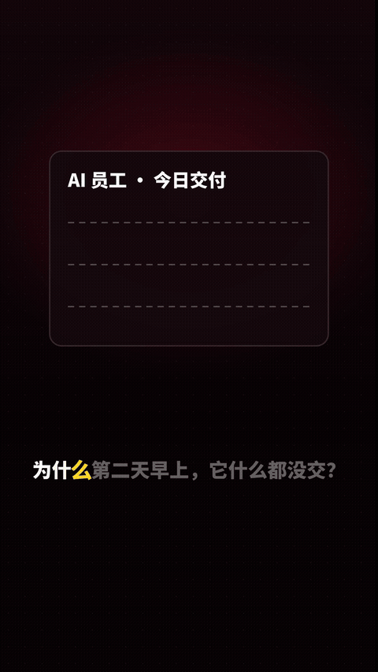
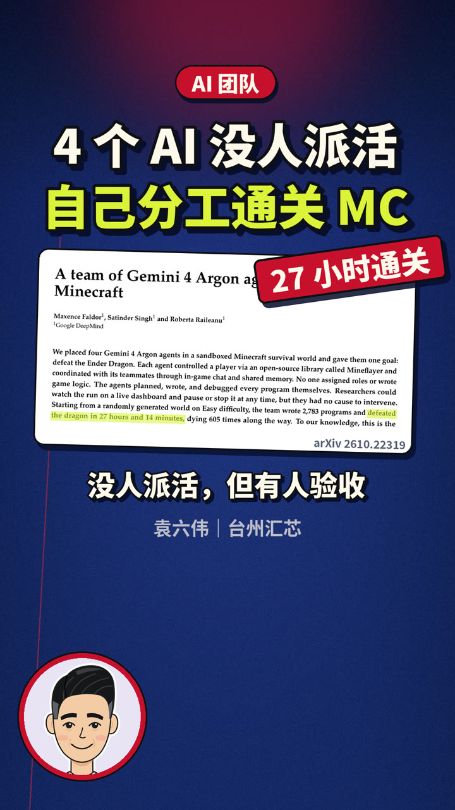

# 口播短视频 Skill（talking-head-video）

> 🔴 **作者：袁六伟 · 台州汇芯**｜一人 AI 公司创业者，6000+ 学员，100+ 客户，得到/华为分享老师
> 📮 更多 AI 视频与自动化实战，关注 **公众号 / 视频号：袁六伟**

## 效果展示

<p align="center"></p>

<p align="center"><sub>逐字字幕演示：字幕跟着语音一个字一个字亮起来，再配上对话气泡分镜</sub></p>

| 首帧封面 | 逐字高亮字幕 | 双栏版式加真实截图 |
|:---:|:---:|:---:|
|  |  |  |
| 封面就是第一帧：大标题、论文截图（注明 arXiv 出处）、署名加卡通头像 | 底部字幕条跟着口播逐字点亮，中间同步放大金句 | 分栏卡片里嵌真实论文截图，并标注出处 |
| **分镜画面** | **收尾版式** | |
|  |  | |
| 用对话气泡和道具来演示观点，字幕逐字推进 | 填空卡、角色卡，头像放在角标里出镜 | |

> 以上画面都由本 Skill 渲染，来自作者自己的口播成片。论文截图版权归原作者所有，仅作引用示例。

用 AI agent 把一篇口播稿做成竖屏口播短视频，配音、校对、逐字字幕、画面渲染、响度归一和质检都包在一条命令里。

*An Agent Skill for talking-head short videos: TTS, ASR check, word-level captions, rendering, loudness normalization and QC in one pipeline.*

## 安装

```bash
npx skills add sixwei2025/talking-head-video-skill
```

也可以把 `skills/talking-head-video/` 整个文件夹拷进你的 agent 的 skills 目录，Claude Code、Codex、WorkBuddy 等支持 SKILL.md 的 agent 都能用。

## 依赖

**必需**
- Python 3.10 及以上，装 `pip install -r skills/talking-head-video/requirements.txt`（numpy、Pillow）
- ffmpeg 5 及以上，要带 libx264 和 loudnorm
- 中文字体，可以用环境变量 `THV_FONT` 指定

**可选**
- Node 18 及以上加 puppeteer-core，Chrome 路径用 `CHROME_PATH` 指定，用于 HTML 渲染
- faster-whisper 和 pypinyin，用于配音校对
- Voicebox 或任何能输出 wav 的 TTS

完整说明见 `skills/talking-head-video/DEPENDENCIES.md`。

## 快速开始

参考 `skills/talking-head-video/examples/ai-agent-intern/`，用 `scripts/` 里的 run_all 一条命令跑完全流程。没有 TTS 的话可以先用占位音轨把画面和字幕跑通。也可以直接对 agent 说：「用 talking-head-video 把这篇口播稿做成竖屏短视频」。

上传脚本是可选的，只帮你填好发布表单，不会替你点「发表」。

## 许可

MIT。代码全部是自己写的。配音的声音、字体和配乐请使用你自己有授权的资源。

---

## 关于作者

**袁六伟 · 台州汇芯**：一人 AI 公司创业者，6000+ 学员，100+ 客户，得到/华为分享老师。专注 AI 视频与自动化落地。

- 公众号：**袁六伟**
- 视频号：**袁六伟**

这个 Skill 免费开源。觉得有用的话，欢迎点个 ⭐ Star，再关注公众号或视频号「袁六伟」，那里有更多 AI 视频和自动化的实战分享。企业合作也可以通过公众号联系。

更多开源 Skill：[3d-map-video-skill](https://github.com/sixwei2025/3d-map-video-skill)、[psych-kepu-video-skill](https://github.com/sixwei2025/psych-kepu-video-skill)、[dark-infographic-video-skill](https://github.com/sixwei2025/dark-infographic-video-skill)
