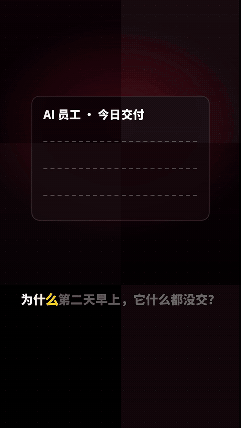
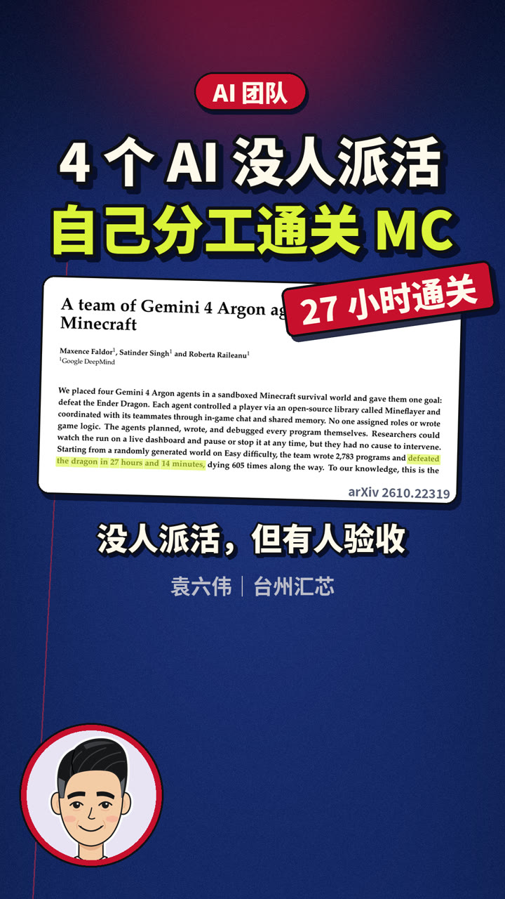
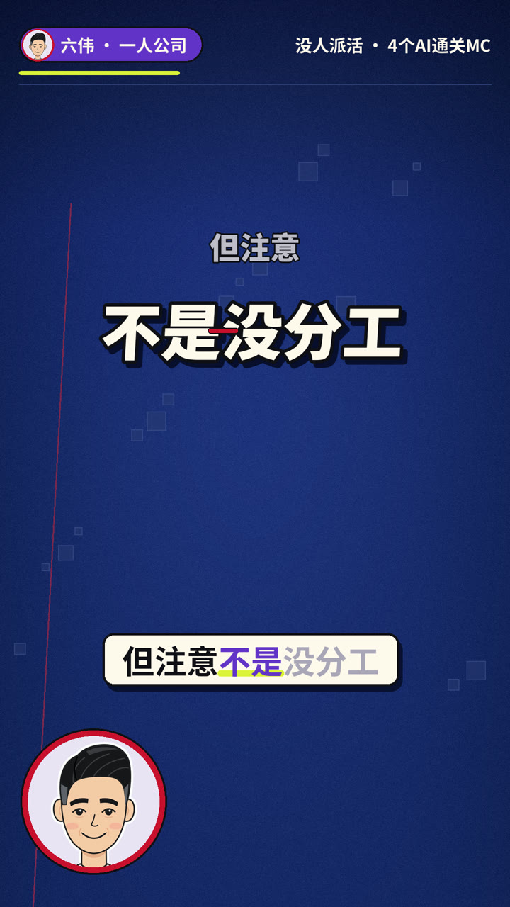
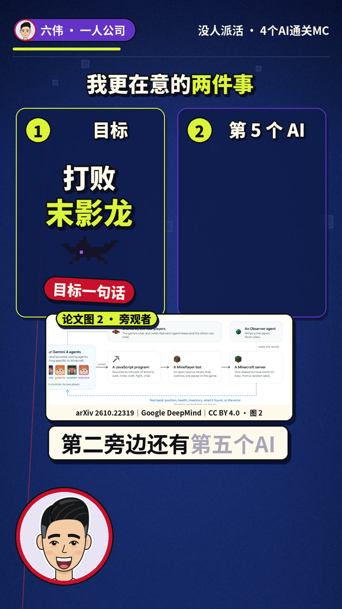
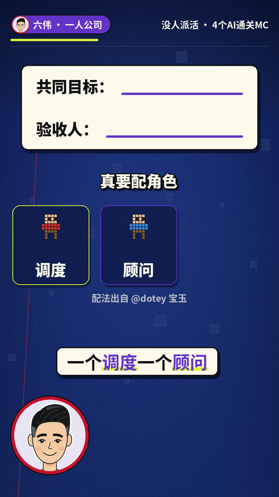
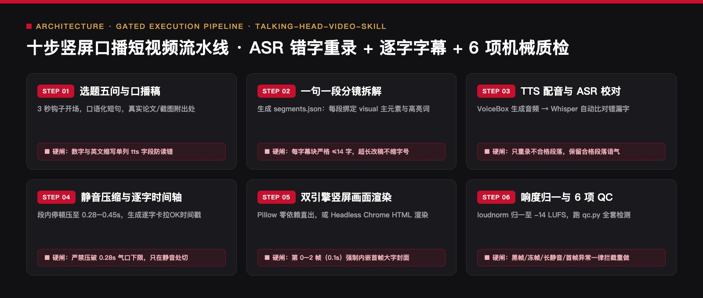

<div align="center">


# 竖屏口播短视频全链路 Skill
### `talking-head-video-skill` · 克隆配音 + ASR 错字重录 + 逐字卡拉OK字幕 + 6 项成片质检

[](https://agentskills.io)
[](#二十步口播工程流水线与架构图)
[](#一看真实渲染效果逐字卡拉ok字幕--动态分镜)
[](#四六项自动化成片质检qcpy)

> 🔴 **作者：袁六伟 · 台州汇芯**｜一人 AI 公司创业者，学员 7000+，客户 100+，得到 / 华为分享老师  
> 📮 更多 AI 视频与自动化实战，关注 **公众号 / 视频号：袁六伟**

**把一篇口播稿变成能直接发视频号/抖音的 1080×1920 竖屏成片，中间不碰剪辑轨。**  
一条 `run_all.sh` 命令串起：**口播稿分镜 → TTS/克隆声配音 → Faster-Whisper ASR 自动校对错漏字并局部重录 → 气口静音压缩（0.28–0.45s） → 逐字点亮卡拉OK字幕 → 双引擎画面渲染 → `-14 LUFS` 广播级响度归一 → 6 项 FFmpeg 成片自动质检**。

```bash
# 一键安装 Skill
npx skills add sixwei2025/talking-head-video-skill

# 零 TTS 最小体验路径（用内置占位音轨 40 秒跑通完整画面、逐字字幕与质检报告）
mkdir my-video && cp skills/talking-head-video/examples/ai-agent-intern/{config.json,segments.json} my-video/
cd my-video && PLACEHOLDER=1 TONE=1 SLUG=demo bash ../skills/talking-head-video/scripts/run_all.sh
```

[看逐字字幕动效](#一看真实渲染效果逐字卡拉ok字幕--动态分镜) · [十步工程流水线](#二十步口播工程流水线与架构图) · [ASR 校对与气口控制](#三核心护城河asr-局部重录与气口呼吸算法) · [6 项成片质检](#四六项自动化成片质检qcpy) · [安装与依赖](#五环境依赖与快速上手)

</div>

## 版本记录

当前版本：`v1.0.0` · 2026-11-13
完整变化记录见 [CHANGELOG.md](CHANGELOG.md)。


## 新手安装：把链接发给 AI

打开 Codex、WorkBuddy，或其他支持技能安装的 AI 智能体，把下面这段话直接发到对话框，让它帮你安装：

```text
帮我安装这个仓库里的技能：
https://github.com/sixwei2025/talking-head-video-skill
```

不需要自己先敲安装命令，按 AI 的提示完成即可。安装后可以接着问：“这个技能怎么用？带我做一个最简单的例子。”

需要使用能够读取仓库、操作本地文件并支持技能安装的 AI；如果当前平台不支持，它可以提供手动安装指引。部分技能还需要额外软件或账号配置，安装技能与完成这些配置是两步，按本页说明和 AI 提示继续。


---

## 一、看真实渲染效果（逐字卡拉OK字幕 + 动态分镜）

<p align="center">
  
  <br /><sub><b>▲ 逐字高亮字幕实拍</b>：字幕严格跟随语音节奏逐字点亮，中部同步展示对话气泡与核心金句</sub>
</p>

| 首帧大字封面（第 0–2 帧） | 逐字点亮字幕 + 核心词放大 | 双栏版式 + 真实论文截图出处 |
| :---: | :---: | :---: |
|  |  |  |
| 0.01s 自动抓取：大标题 + arXiv 截图 + 头像 | 每块严格 ≤14 字，关键词自动标红 `#E5283A` | 拒绝空口白话，分栏卡片内嵌真实证据与出处 |

| 多角色对话气泡分镜 | 收尾总结卡 + IP 角标出镜 |
| :---: | :---: |
|  |  |
| 用微信式对话气泡演绎多智能体协作过程 | 结构化填空卡 / 角色卡收束全片观点 |

---

## 二、十步口播工程流水线与架构图

<p align="center">
  
</p>

| 步骤 | 环节 | 执行脚本 / 模板 | 产物 | 关键工程纪律 |
| :---: | :--- | :--- | :--- | :--- |
| **01–03** | **选题 → 口播稿 → 分镜** | `templates/口播稿模板.md` · `分镜模板.md` | `script.md` + `segments.json` | 3 秒钩子开场；一句一段；屏幕显示 `text` 与发音 `tts` 分离（防读错英文/年份） |
| **04** | **TTS 配音与 ASR 校对** | `voicebox_client.py` → `asr_check.py` → `assemble_voice.py` | `build/voice/voice.wav` + `timing.json` | **每段只生成 1 遍**；ASR 比对出读错的段落打印 `REGENERATE: s03`，只局部重录该段 |
| **05** | **逐字时间轴与字幕分块** | `build_captions.py` | `build/captions.json` | **每块字幕严格 ≤14 字**（超长报错要求改稿，绝不靠缩小字号硬塞） |
| **06** | **双引擎竖屏渲染** | `render_pillow.py`（零前端依赖）或 `render_html.mjs` | `build/render.mp4` | 确定性逐帧接口 `window.THV.seek(frame, fps)`，支持 Pillow 直出或 Chrome 渲染 |
| **07–08** | **响度归一与首帧封面** | `loudnorm.sh` | `build/final.mp4` + `cover.png` | 两遍归一至 `-14 LUFS / -1.5 dBTP`；第 0–2 帧（0.1s）压入封面供平台自动抓图 |
| **09–10** | **6 项成片质检与交付** | `qc.py` | `build/qc.txt` + `deliver/` | 全部质检项 PASS 才写出 `build/DONE`；交付目录只留成片与发布说明 |

---

## 三、核心护城河：ASR 局部重录与气口呼吸算法

做 AI 配音口播最怕两件事：**一是 TTS 吞字读错，二是段间停顿要么死长要么剪得喘不过气**。

1. **屏幕词与发音词双轨制（`text` vs `tts`）**：在 `segments.json` 中，屏幕上显示 `"2026年 AI Agent"`，而传给 TTS 的 `tts` 字段写 `"二零二六年 A I Agent"`，从源头杜绝数字和英文缩写误读。
2. **Faster-Whisper 自动听审**：配音完成后自动跑 `asr_check.py` 转写比对拼音编辑距离，精准揪出吞字段落，用 `--only s03,s07` 局部重录，完好保留其余合格段落的语气。
3. **生理级气口压缩（0.28s 下限保护）**：`assemble_voice.py` 只在真实静音中点下刀，将超过 `0.45s` 的长停顿压缩，但**严格保底 `min_gap = 0.28s`**，避免剪出令人窒息的机械连珠炮。

---

## 四、六项自动化成片质检（`qc.py`）

成片交付前强制执行 `python3 scripts/qc.py`，任何一项不过直接判 `FAILED`：

- ✅ **规格校验**：分辨率 `1080×1920`，编码 `H.264 + AAC 48kHz`，音轨完整。
- ✅ **黑帧检测（`blackdetect`）**：持续 `≥0.1s`、像素阈值 `0.05` 的黑屏帧必须为 **0**。
- ✅ **冻帧检测（`freezedetect`）**：持续 `≥2.0s` 的完全静止画面必须为 **0**（倒逼背景加入呼吸光斑或微动效）。
- ✅ **死寂检测（`silencedetect`）**：正文内 `≥0.30s` 的异常死寂段为 **0**，片尾留白 `≤0.30s`。
- ✅ **广播级响度（`loudnorm`）**：整体响度落在 `-16 ~ -12 LUFS`（目标 `-14 LUFS`），真峰值 `≤ -1.0 dBTP`。
- ✅ **首帧封面校验**：第 0 帧必须与第 4 帧显著不同，确保视频号/抖音 0.01 秒抓取封面百发百中。

---

## 五、环境依赖与快速上手

### 1. 安装 Skill
```bash
npx skills add sixwei2025/talking-head-video-skill
```

### 2. 环境依赖
- **必需**：Python 3.10+（`pip3 install numpy Pillow`）、FFmpeg 5+（带 `libx264` 与 `loudnorm`）、任意中文字体（可通过 `THV_FONT` 指定）
- **可选增强**：Node 18+ & `puppeteer-core`（用于 HTML 高阶动效渲染）、`faster-whisper` & `pypinyin`（用于 ASR 自动校对）、VoiceBox 或任意可输出 WAV 的 TTS 服务。详见 [`DEPENDENCIES.md`](skills/talking-head-video/DEPENDENCIES.md)。

---

## 六、仓库目录结构

```text
talking-head-video-skill/
├── README.md                                  # 仓库总览与逐字字幕效果展示
├── LICENSE                                    # MIT 开源许可
├── assets/showcase/                           # 卡拉OK字幕 GIF、5 类分镜抽帧与十步架构图
└── skills/talking-head-video/
    ├── SKILL.md                               # 【总控入口】十步流程、关键参数表、质检标准与常见坑
    ├── DEPENDENCIES.md                        # 必需与可选依赖详细安装指南
    ├── templates/                             # 口播稿模板、分镜模板、发布说明与 vertical.html 渲染页
    ├── references/                            # 选题五问、口播稿写法、配音规则、封面首帧规则与质检清单
    ├── examples/ai-agent-intern/              # ★ 开箱即跑的完整示例工程（含 config.json 与 segments.json）
    └── scripts/
        ├── run_all.sh                         # ★ 一条命令跑通字幕→渲染→响度→封面→质检→交付
        ├── voicebox_client.py                 # TTS 客户端（支持断点续跑与 --only 局部重录）
        ├── asr_check.py                       # Faster-Whisper + 拼音距离自动听审校对器
        ├── assemble_voice.py                  # 智能气口裁剪与逐段时间戳生成器
        ├── build_captions.py                  # 逐字卡拉OK时间轴与每屏 ≤14 字分块检查
        ├── render_pillow.py / render_html.mjs # 双引擎竖屏画面渲染器
        ├── loudnorm.sh                        # FFmpeg 两遍广播级响度归一脚本
        └── qc.py                              # ★ 6 项音画成片自动质检器
```

---

## 关于作者与开源生态

**袁六伟 · 台州汇芯**：一人 AI 公司创业者，学员 7000+，服务商单客户 100+，覆盖近 20 个行业，得到 / 华为分享老师。AI 变现实战派，自己跑通才拿出来教。

- 公众号：**袁六伟**（微信搜一搜关注，看更多 AI 工具实测与一人公司实战）
- 视频号：**袁六伟**

这个项目免费开源。如果它帮你的产线省下了每天反复返工的时间，欢迎在右上角点个 ⭐ **Star**，也欢迎转发给身边做内容或一人公司的朋友。

### 同系列开源 Skill 矩阵（袁六伟 · 台州汇芯）

| 仓库 | 领域 | 核心能力 |
| :--- | :--- | :--- |
| [**workbuddy-wechat-autopilot**](https://github.com/sixwei2025/workbuddy-wechat-autopilot) | 公众号全链路 | 九步全自动总控：选题→写稿→真实截图→6套封面→6套排版→三重自动质检→草稿箱 |
| [**wechat-cover-skill**](https://github.com/sixwei2025/wechat-cover-skill) | 公众号视觉 | 封面渲染引擎（6套高客单价杂志风 + 黑红金 v2b + 防压脸自动校验） |
| [**gzh-million-layout-skill**](https://github.com/sixwei2025/gzh-million-layout-skill) | 公众号排版 | 汇芯红 `#C8102E` 六套 100% 内联 CSS 骨架 + 零乱码检查 + 配图皮肤 |
| [**ai-tool-review-wechat-skill**](https://github.com/sixwei2025/ai-tool-review-wechat-skill) | 公众号评测 | AI 工具真跑评测工作流（2.0 全自动压测 + 去碎句语感质检 + 六套骨架装配） |
| [**hit-title-expert-skill**](https://github.com/sixwei2025/hit-title-expert-skill) | 爆款标题 | 一次直出 10 条 14–22 字高浓缩狠标题（5大公式 × 5类钩子词） |
| [**auto-tutorial-skill**](https://github.com/sixwei2025/auto-tutorial-skill) | 短视频工程 | 链接/网页/真机截图 → 3:4 封面 + 1.5x 配音 + 红框标注教程视频 |
| [**talking-head-video-skill**](https://github.com/sixwei2025/talking-head-video-skill) | 短视频工程 | 1080×1920 竖屏真人口播短视频（ASR 错字校对 + 逐字卡拉OK字幕 + 6项QC） |
| [**3d-map-video-skill**](https://github.com/sixwei2025/3d-map-video-skill) | 短视频工程 | MapLibre 3D 地形 + WarFX 战争特效（粒子行军/点阵兵力/震屏混音） |
| [**psych-kepu-video-skill**](https://github.com/sixwei2025/psych-kepu-video-skill) | 短视频工程 | Remotion + JSON 驱动的 15–30s 深色扁平动画心理科普短视频 |
| [**dark-infographic-video-skill**](https://github.com/sixwei2025/dark-infographic-video-skill) | 短视频工程 | 纯 Python + FFmpeg 暗黑流光数据可视化科普片（含 v2 手机外放配乐） |
| [**local-video-hub**](https://github.com/sixwei2025/local-video-hub) | AI 团队基建 | 视频版本地 Obsidian：多 AI 员工统一交片、撞题查重与四态流转云台 |
| [**yuanliuwei-ai-skills**](https://github.com/sixwei2025/yuanliuwei-ai-skills) | 一人公司方法 | PACT 72h 需求验证模型与一人 AI 公司 10 大业务决策模块 |
| [**book-skill**](https://github.com/sixwei2025/book-skill) | 知识工程 | 上传任意书籍 PDF → 自动提炼方法论生成 `.skill` + 公众号导流文案 |
| [**huangdi-skill**](https://github.com/sixwei2025/huangdi-skill) | 认知操作系统 | 中国历史八大皇帝（秦始皇/汉武帝/唐太宗等）一手史料认知框架蒸馏 |
| [**sunrise-tracker**](https://github.com/sixwei2025/sunrise-tracker) | 选题雷达 | 小红书 AI 赛道 10 倍异常流量「低粉爆文」每日早 7 点监测推送 |
